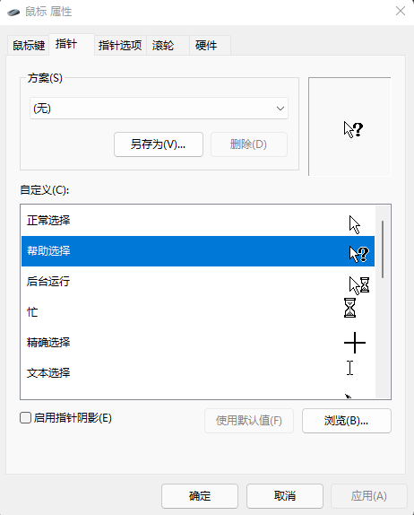
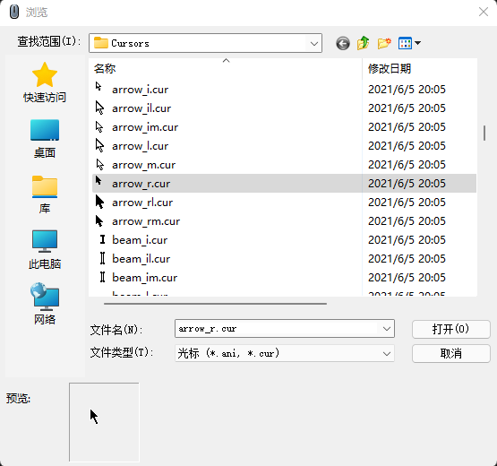
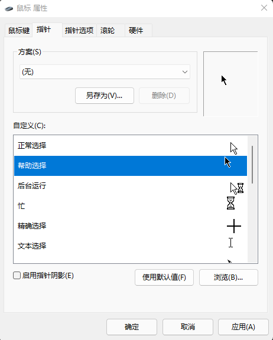
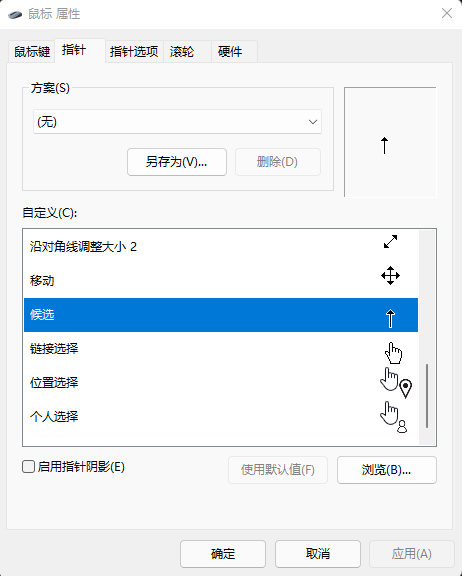
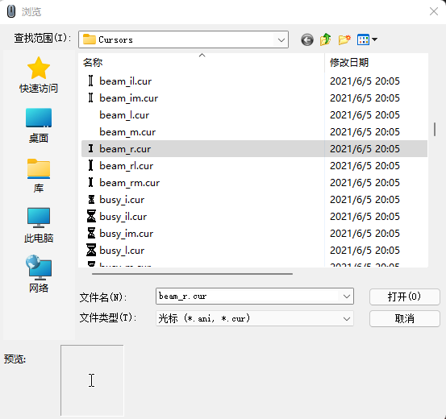
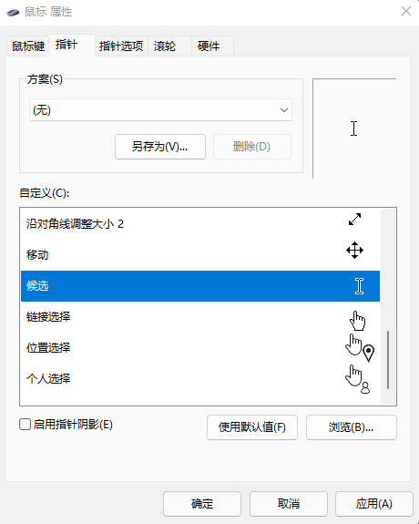
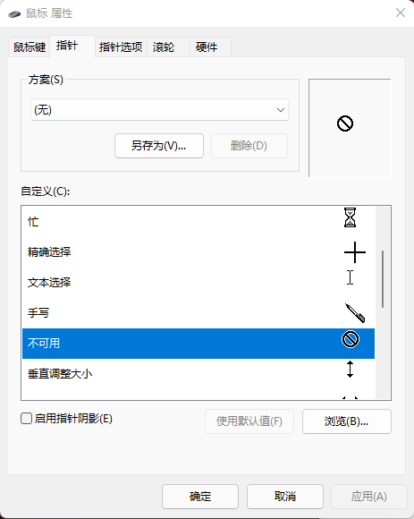
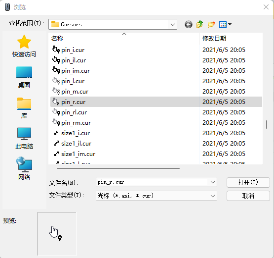
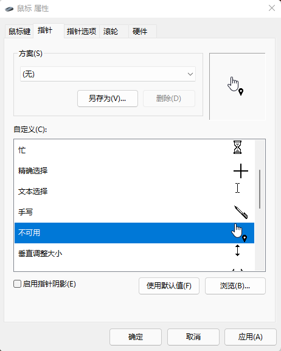
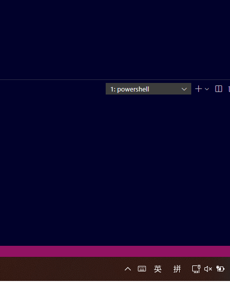

# DynCursor

[项目主页](https://alvinfunborn.github.io/DynCursor/) · [Windows 图文设置指南](https://alvinfunborn.github.io/DynCursor/guide.html) · [下载 v1.1.1](https://github.com/alvinfunborn/DynCursor/releases/latest) · [赞助说明](https://alvinfunborn.github.io/DynCursor/sponsor.html)
1.1.0 提供设置窗口、托盘菜单、登录自启动和直接选择光标文件，默认附带三枚原创光标。下方保留 Windows 来源映射的原理与手动配置说明。

## Windows系统动态修改鼠标指针光标图标样式, 根据键盘布局/语言/输入法的切换而变化.

假如在Windows上安装了多门语言, 使用时可能很难感知当前是什么语言什么输入法, 需要频繁查看任务栏语言图标或者直接打字来判断, 加上微软拼音输入法会"智能"切换中/英, 十分影响心态;

此工具能帮助快速判断所用的输入法, 通过简单几步配置, 即可在使用英文时看到鼠标白色指针, 使用中文时看到鼠标黑色指针(也可以[下载](http://www.rw-designer.com/cursor-library/set-0)或自制其他颜色和图标的指针);

实现思路是定期查询前台窗口的键盘布局和输入法状态。如果当前语言匹配配置，且输入法处于本地语言输入模式（`IME_CMODE_NATIVE`），则替换鼠标指针；普通键盘布局直接按语言编码匹配。默认配置针对`中文(简体,中国)`：
1. `正常选择`<image src="resources/figure/aero_arrow.cur" height="20" width="20"></image>替换为`帮助选择`<image src="resources/figure/aero_helpsel.cur" height="20" width="20"></image>
1. `文本选择`<image src="resources/figure/beam_r.cur" height="20" width="20"></image>替换为`候选`<image src="resources/figure/up_r.cur" height="20" width="20"></image>
1. `链接选择`<image src="resources/figure/aero_link.cur" height="20" width="20"></image>替换为`不可用`<image src="resources/figure/aero_unavail.cur" height="20" width="20"></image>

程序启动时会保存映射中涉及的光标副本。在自定义输入法状态下，目标光标使用替换光标的图案；切回默认状态时，目标光标恢复为启动时的图案。替换光标本身保持原样。因此只需要把`帮助选择`<image src="resources/figure/aero_helpsel.cur" height="20" width="20"></image>的图标修改成其他颜色指针<image src="resources/figure/arrow_r.cur" height="20" width="20"></image>，即可实现动态光标颜色；其他鼠标指针状态同理。
默认取代`帮助选择`<image src="resources/figure/aero_helpsel.cur" height="20" width="20"></image>,`候选`<image src="resources/figure/up_r.cur" height="20" width="20"></image>,`不可用`<image src="resources/figure/aero_unavail.cur" height="20" width="20"></image>是因为这些指针状态极少出现, 或者可以在[配置文件](config/config.yaml)中修改成其他替换指针;

## 使用（设置窗口）

要求 Windows 10 / 11 x64 和 [Microsoft Edge WebView2 Runtime](https://developer.microsoft.com/microsoft-edge/webview2/)。下载 ZIP 后完整解压到可写的固定目录，无需管理员权限。升级前先退出旧版；0.2.1 需要从任务管理器退出。

1. 双击 `DynCursor.exe`，进入 **光标设置**，按三步完成：选语言 → 选图案 → 保存并试一试。微软拼音直接选“简体中文”，不必填写编码。
2. **直接选图案**：点击“使用内置绿色光标”，或为箭头、文字里的 I 形、链接上的小手分别选 `.cur` 文件（不支持 `.ani`，最大 2 MB）。窗口会并排说明原图案与替换图案。
3. **按 README 设置 Windows**：已经配置过系统指针的，继续沿用原来的方案；窗口按“打开 Windows 设置 → 修改帮助选择/候选/不可用并应用 → 继续切换”引导，提供逐步截图入口。选择这个说明页本身不会改动配置。
4. 点击“保存并应用”，再点“打开记事本试一试”，切换中英文验证。勾选框控制三类光标是否参与切换。
5. **启动与托盘**：设置登录自启、打开程序时不弹窗口、关闭窗口继续运行。登录自启立即生效，其他选项保存后生效。
6. **更多设置**：检测间隔、稳定时间、映射编码、配置文件、日志和恢复功能折叠收纳，日常使用无需修改。

关闭窗口默认只隐藏，后台继续运行。左键托盘图标打开设置，右键可暂停、打开 Windows 指针设置、重新读取 Windows 图案和退出。再次双击程序会唤出已有窗口。退出使用“恢复光标并退出”或 `--stop`；强制结束进程无法执行自动恢复。

窗口设置以草稿形式编辑，点击“保存并应用”才写入。配置保存失败时保留旧配置；未知 YAML 字段会保留，注释和格式会重新生成。手动修改文件后，可用“重新读取配置”。

### Windows 来源指针与完整恢复

如果希望复用 Windows 方案，在窗口清空直接文件，按 [Windows 图文设置指南](https://alvinfunborn.github.io/DynCursor/guide.html) 操作。指南保留下面九张 README 历史截图，补充 Win10/11 入口、当前文件名、暂停/捕获、指针可见性、自启和排错。

先保存原始 Windows 指针方案，再设置“帮助选择→箭头”、“候选→I 形”、“不可用→手形”，点“应用”后重新读取 Windows 图案。历史截图图案与新版原创素材不同，请按当前文件名选择。

<details><summary>展开九张历史 Windows 设置截图</summary>











</details>

建议在 `鼠标属性 → 指针选项` 取消“在打字时隐藏指针”，可选开启“当按 CTRL 键时显示指针的位置”。窗口里的“打开 Windows「指针」设置”能快速到达系统指针选项卡。

暂停和正常退出恢复本次捕获的目标光标。`--reset-cursors` 或窗口的“重载 Windows 已保存方案”重新加载当前保存方案，并非出厂设置；要彻底还原来源指针，请在 Windows 中选回事先保存的原始方案并应用。

命令行选项：

```powershell
.\DynCursor.exe --version
.\DynCursor.exe --check-config
.\DynCursor.exe --check-config C:\path\to\config.yaml
.\DynCursor.exe --show
.\DynCursor.exe --background
.\DynCursor.exe --stop
.\DynCursor.exe --reset-cursors
```

`--check-config` 返回 0 表示有效，非 0 表示失败，不修改系统光标。输入法查询超时或前台窗口暂不可用时保留上一次状态。受保护窗口、第三方输入法或自行绘制指针的应用需要按实际环境验证。

## 从源码构建

在安装了 Rust MSVC 工具链和 Visual Studio C++ Build Tools / Windows SDK 的 Windows 上运行：

```powershell
cargo test --locked
cargo clippy --locked --all-targets -- -D warnings
cargo build --locked --release
Copy-Item config,resources target/release -Recurse -Force
node --test scripts/test-settings.cjs
./scripts/package.ps1
```

设置 UI 为静态 HTML/CSS/JS，Tauri 直接嵌入，无需 npm 构建。重新生成图标或示例光标时需要 Node.js 与 `sharp`，执行 `node scripts/build-icons.cjs` / `node scripts/build-cursors.cjs`；更新依赖后执行 `python scripts/collect-licenses.py`。

随后运行 `target/release/DynCursor.exe`。回归测试使用模拟光标，不修改桌面的系统指针。GitHub Actions 会执行检查并生成包含程序、配置及示例光标的便携 ZIP。

当前版本为 `1.1.1`，源码版本、Windows 文件版本与 Git 标签保持一致。更新内容见 [CHANGELOG.md](CHANGELOG.md)。历史 `v0.2.1` 中的 `Cargo.toml` 曾保留 `0.1.0`，属于元数据未同步。

## 支持项目

欢迎通过 Star、反馈问题和改进文档支持维护。收款入口正在准备中，暂未开放；后续会统一更新[赞助说明页](https://alvinfunborn.github.io/DynCursor/sponsor.html)。

## 许可证

源码及原创文档采用 [MIT License](LICENSE)。第三方组件、Windows 界面元素和历史下载的光标素材保留各自的权利与授权，详见 [THIRD_PARTY_NOTICES.md](THIRD_PARTY_NOTICES.md) 及 [THIRD_PARTY_LICENSES.txt](THIRD_PARTY_LICENSES.txt)。新版 Logo、`resources/cursor-source/*.svg` 与三个 `custom-*.cur` 为原创，采用 MIT。其余历史 `.cur` 来源未逐一核实，不包含在本项目自有 MIT 授权中，也不进入新版便携发布包。

## 效果图
- 使用个性化图标



## 如何设置开机自启动

在窗口“启动与托盘”开启登录自启动；如果使用过下面的手动快捷方式，请删除重复项。

[在 Windows 中更改哪些应用在启动时自动运行](https://support.microsoft.com/zh-cn/windows/%E5%9C%A8-windows-%E4%B8%AD%E6%9B%B4%E6%94%B9%E5%93%AA%E4%BA%9B%E5%BA%94%E7%94%A8%E5%9C%A8%E5%90%AF%E5%8A%A8%E6%97%B6%E8%87%AA%E5%8A%A8%E8%BF%90%E8%A1%8C-9115d841-735e-488d-e749-9ba301d441e6#ID0EBD=Windows_10)

## 附录
### 常用语言编码
语言|编码
-|-
中文(简体,中国)|0804
中文(繁体,中国台湾)|0404
中文(繁体,中国香港)|0C04
中文(繁体,中国澳门)|1404
英语(美国)|0409
英语(英国)|0809

更多编码参考[Windows Language Code Identifier (LCID) Reference](https://docs.microsoft.com/en-us/openspecs/windows_protocols/ms-lcid/70feba9f-294e-491e-b6eb-56532684c37f)

### 指针状态编码
状态|样式|编码
-|-|-
正常选择|标准箭头|32512
帮助选择|标准箭头+问号|32651
后台运行|标准箭头+小沙漏|32650
忙|沙漏|32514
精确选择|十字|32515
文本选择|I|32513
不可用|斜线圆圈|32648
垂直调整大小|南北向双向箭头|32645
水平调整大小|东西向双向箭头|32644
沿对角线调整大小1|西北-东南的双向箭头|32642
沿对角线调整大小2|东北-西南的双向箭头|32643
移动|四向箭头|32646
候选|向上的箭头|32516
链接选择|手指|32649

更多编码参考[The name of the cursor resource](https://docs.microsoft.com/en-us/windows/win32/api/winuser/nf-winuser-loadcursorw)
